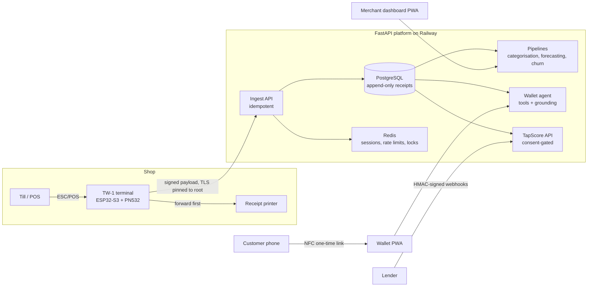
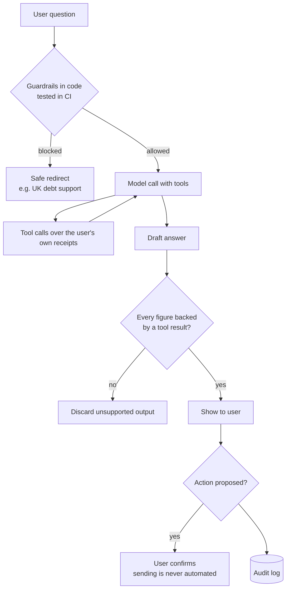

# Tapworth

**A small NFC terminal sits between a shop's till and its receipt printer and reads every line item as it prints. One capture feeds three products: merchant intelligence, a receipt wallet with an AI agent, and a consent-gated financial identity score.**

**Live:** [tapworth.co.uk](https://tapworth.co.uk) | **Role:** Founder and sole engineer, Tapworth Technologies Ltd (UK)

> **Where it actually is:** the platform is built and deployed. No merchant pilot has run yet, and there are no users or revenue. Founding pilot shops are next.
>
> This repo is a showcase. It contains no source code, credentials, scoring weights or customer data.

---

## The problem

A receipt is the only record of what was actually bought: product, price, quantity, VAT. Banks never see it, shops can't search it, and thermal paper fades. Open banking sees "£47 at Tesco". Tapworth sees the 23 items inside.

## How it works

1. **Capture.** The terminal sits inline on the printer cable. It forwards every byte to the printer first and parses the ESC/POS stream as a side effect. The POS is never asked for anything, so it works on tills it has never seen.
2. **Tap.** The terminal emulates an NFC tag holding a one-time link. The customer's phone opens an itemised receipt in the browser. No app, no signup.
3. **Use.** Structured line items flow into three products.

| Layer | What it does |
|---|---|
| **Merchant intelligence** | Basket analysis, per-item demand forecasts printed as prep sheets, lapsed-regular detection, anonymised peer benchmarks, staff analytics, month-end accountant packs, multi-location roles |
| **Receipt wallet and agent** | Finds forgotten subscriptions, tracks warranty and return windows, compares prices, and drafts cancellations and claims, at the level of autonomy the user sets |
| **TapScore** | A 300 to 900 financial identity score built from four auditable arithmetic pillars (no black-box model), returned only after per-purpose consent |

## Architecture

### How the agent answers a question

## Key engineering decisions

**AI**
- **Grounding is enforced after generation.** No figure reaches the user without a tool result behind it. Unsupported output is thrown away, not shown with a warning.
- **Guardrails run before any model call**, in code, with CI tests: no health or nutrition framing, no regulated financial advice, and distress routed to UK debt support.
- **The user owns agent memory.** The agent can only offer to remember something; the user's tap creates the record.
- **Autonomy dial with a hard floor.** Notify, ask first, or handle it. Even at the most autonomous setting, only reversible actions run, and sending anything always waits for the user.
- **Cost engineering.** About $0.021 per question and about $0.43 per active user per month, with a daily per-user cap.

**Security and reliability**
- Field-level AES-256-GCM encryption with versioned tokens, and a blind index on phone numbers.
- Redis rate limiting **fails open**; session revocation **fails closed**. Deliberately opposite, because a rate-limiter outage shouldn't lock everyone out, but a revocation outage must not let a revoked session through.
- Ingest idempotency lives in a database unique index, because the firmware's on-device queue can outlive any Redis TTL.
- Firmware TLS is pinned to the ISRG Root X1 root certificate, not the leaf, which rotates every 90 days.
- Merchant analytics enforce a minimum cohort of five, with a test that enumerates the routing table so no endpoint slips through.
- Scheduled jobs use APScheduler with a Redis distributed lock, added after two workers sent duplicate merchant emails.
- Receipts are immutable events. Every total, score and refund is derived and replayable. Money is stored in minor units, never floats.
- GDPR consent, export and erasure. HMAC-signed lender webhooks, OTP verification, and anonymous-to-verified wallet merging.

**Hardware**
- A **normally closed relay** means that if the terminal loses power or crashes, the till connects straight through to the printer. A shop can never lose a sale because of Tapworth.
- The terminal queues receipts locally when offline and sends them on reconnect.

**Front end**
- Full **Arabic right-to-left** support and dark mode. Every string goes through one translation function, with automated English/Arabic parity checks and a measured contrast auditor.
- Vanilla JavaScript ES modules with no build step, served as progressive web apps.

## Stack

| Area | Technology |
|---|---|
| Backend | Python, FastAPI, SQLAlchemy 2, Alembic, PostgreSQL, Redis, APScheduler, fpdf2 |
| Front end | Vanilla JavaScript ES modules, PWAs, Web Push (VAPID) |
| Firmware | ESP32-S3, PN532 NFC (ISO 14443 Type 4 emulation) |
| Quality | 575 backend tests, end-to-end smoke suite on every build, CI, structured logging |
| Infrastructure | Docker, Railway (API, Postgres, Redis), Vercel (landing page), Cloudflare DNS, Cloudflare R2 media on a custom subdomain |

## Screenshots and demo

Not yet captured. A demo capture of the parser and the agent's grounding check is in progress, and this section will carry the recording, the merchant dashboard in English and Arabic, and a terminal photo when it is done.

In the meantime the platform is live at **[tapworth.co.uk](https://tapworth.co.uk)**, and I am happy to walk through the running system on a call.

---

Source code is private. I'm happy to walk through the system live. **Contact:** [mohd.wali.uddin.2003@gmail.com](mailto:mohd.wali.uddin.2003@gmail.com) | [GitHub profile](https://github.com/M9Bazooka)
